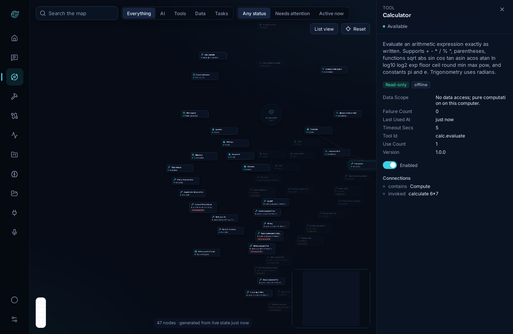
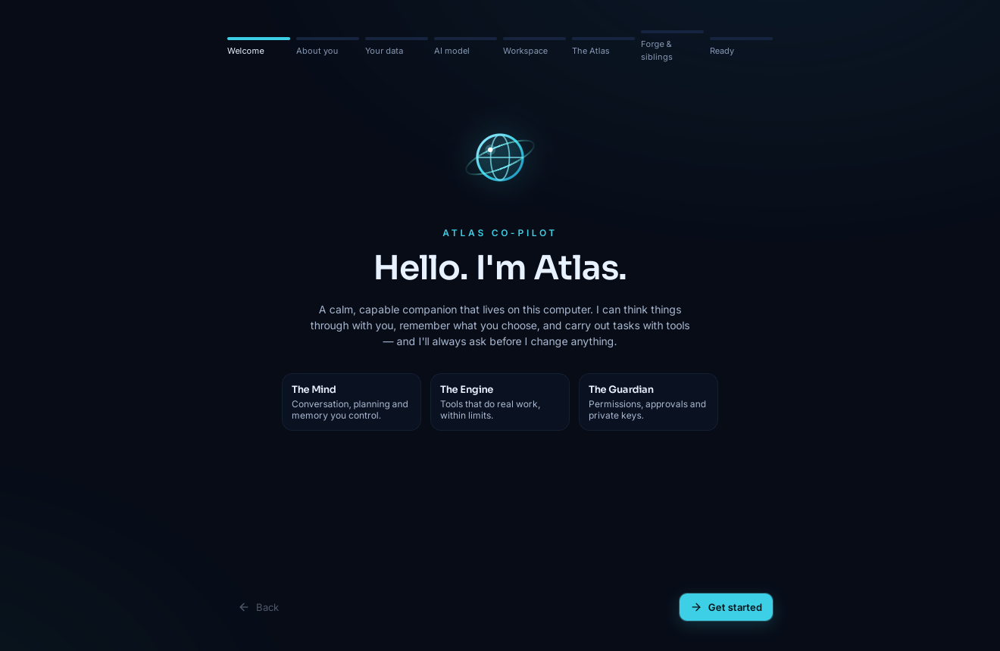
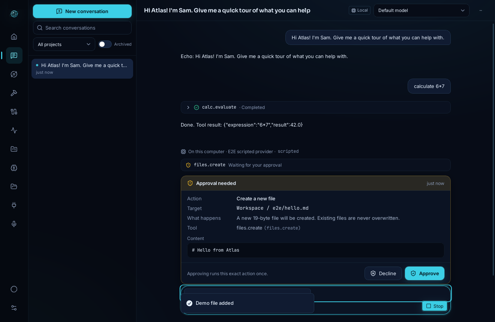
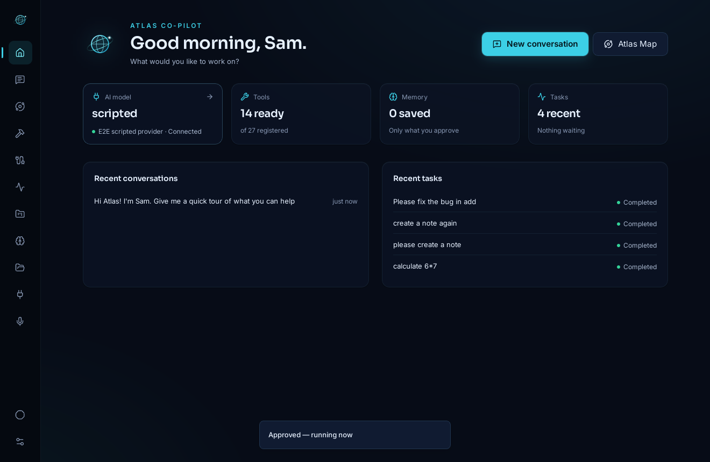
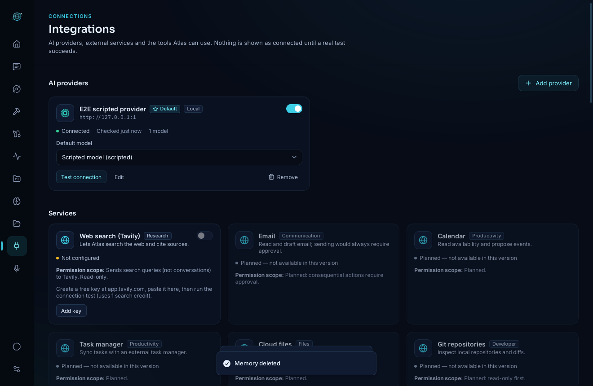
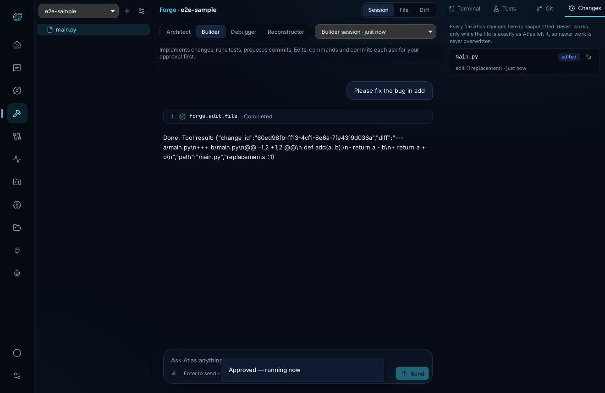
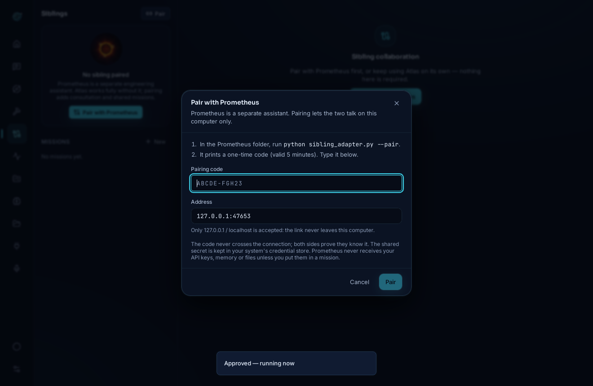

# ATLAS Co-Pilot

A local-first AI desktop companion and personal command center. Atlas talks with you through the AI
provider you choose, remembers only what you approve, carries out tasks with a set of permission-checked
tools, and shows everything it can reach on a live **Atlas Map**.

> **Just want to use it on Windows? → [How to install ATLAS Co-Pilot](../INSTALL.md)**
> ([download the installer](https://github.com/Nacrozma/Prometheus/releases/download/atlas-v0.1.0/ATLAS-Co-Pilot-Setup-x64.exe))



| | |
|---|---|
|  |  |
|  |  |
|  |  |

*All screenshots are captured from the real desktop app by the end-to-end test suite (with its scripted test provider).*

## What it does

**The Mind** — streaming conversations with Anthropic (Claude), OpenAI, any OpenAI-compatible service, or
Ollama on your own computer; per-conversation model choice; projects with their own instructions; memory
you can search, edit, pin, scope and delete, with the reason each memory was used.

**The Engine** — 15 built-in tools (calculator, date/time, text & CSV/JSON transforms, workspace file
list/read/create, document drafts, data import/export, memory search/save, web search, diagnostics, provider
health, task status). Every call is schema-validated, time-limited, output-validated and recorded as a task
step in Mission Control.

**The Guardian** — permissions enforced in the trusted Rust core, not just requested of the model.
Read-only tools run freely; anything that writes asks first; consequential actions always ask; destructive
ones are always denied. Each approval covers one exact action (tool + arguments, hashed) and can be used once.
API keys live only in your OS credential store. An emergency stop cancels everything.

**The Atlas** — an interactive graph generated from live state: providers, models, tools, integrations,
memory, projects and running tasks, with active execution paths animated while they run.

## Status

What works now, and what doesn't:

| Area | Status |
|---|---|
| Desktop app, first-run setup, all main screens | Tested end-to-end (real app over WebDriver) on Linux x86_64 and Windows x64 |
| Anthropic and OpenAI-compatible streaming, tool calling | Tested against mock servers that replay each API's wire format. Not yet exercised with a live API key. |
| Ollama (local) | Same adapter as OpenAI-compatible; tested against a mock server |
| Web search (Tavily) | Tested against a mock server; needs your Tavily key |
| Windows | CI on Windows: unit, core and frontend tests, Credential Manager round-trip, launch smoke test, and the desktop e2e suite (incl. accessibility audit) all pass; `.exe`/`.msi` installers built. Installers are **unsigned**. See [docs/WINDOWS.md](docs/WINDOWS.md) |
| macOS | CI builds and unit tests pass; not run interactively; unsigned |
| PDF / Word / Excel reading | **Not supported** (UTF-8 text formats only) |
| Voice | Speech-to-text **not implemented**; read-aloud uses OS voices only where the webview exposes them |
| Email, calendar, cloud files, Git, custom HTTP tools | **Planned**; shown as "not available in this version" |
| Auto-update | **Not implemented**; install new releases manually |

## Quick start (development)

```bash
cd atlas
pnpm install
pnpm tauri dev          # builds the Rust core + shell and opens the app
```

Prerequisites, per-OS notes and the Linux credential-store requirement are in [docs/SETUP.md](docs/SETUP.md).

## Checks

```bash
pnpm typecheck && pnpm lint && pnpm test   # TypeScript, ESLint, Vitest
cargo test --workspace                      # Rust unit + end-to-end core tests
tests/e2e/run.sh                            # drives the real desktop app (Linux, WebDriver)
```

## Repository layout

```
atlas/
  core/          Rust library: the trusted core (providers, tools, policy, approvals, tasks, memory, storage)
  src-tauri/     Tauri 2 desktop shell: window, native dialogs, the IPC command list
  src/           React + TypeScript interface (features/*, components/, lib/, state/, styles/)
  tests/unit/    Vitest unit & component tests
  tests/e2e/     WebDriver tests of the real desktop app
  docs/          Architecture, security, privacy, setup, providers, tools, release, testing, ADRs
```

## Documentation

[Architecture](docs/ARCHITECTURE.md) · [Security](docs/SECURITY.md) · [Privacy](docs/PRIVACY.md) ·
[Setup](docs/SETUP.md) · [Windows](docs/WINDOWS.md) · [Providers](docs/PROVIDERS.md) · [Tool development](docs/TOOL_DEVELOPMENT.md) ·
[Integrations](docs/INTEGRATIONS.md) · [Memory](docs/MEMORY.md) · [Troubleshooting](docs/TROUBLESHOOTING.md) ·
[Release](docs/RELEASE.md) · [Testing](docs/TESTING.md) · [Test report](docs/TEST_REPORT.md) · [Decisions](docs/adr/) · [Changelog](CHANGELOG.md)

**New in 0.2.0:** [Atlas Forge](docs/FORGE.md) · [Pairing with Prometheus](docs/PAIRING.md) · [Sibling Protocol v1](docs/SIBLING_PROTOCOL.md)
